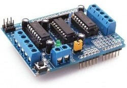
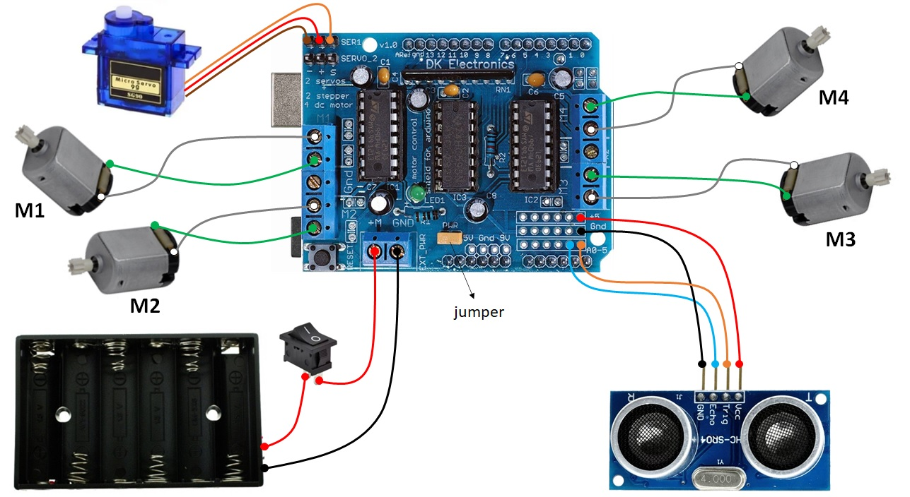

# Configuração do Motor Shield L293D no Arduino

O motor shield L293D é uma placa que pode ser conectada ao arduino, permitindo controlar até 4 motores DC ou 2 motores de passo e 2 servos, sendo muito utilizado em projetos de robótica.
Este repositório ensina a usar o Arduino junto com o Motor Shield L293D para controlar:
- 4 motores de corrente contínua
- 1 micro servo
- 1 sensor ultrassônico HC-SR04

## Autor
Professor José de Assis

## Diagrama elétrico

